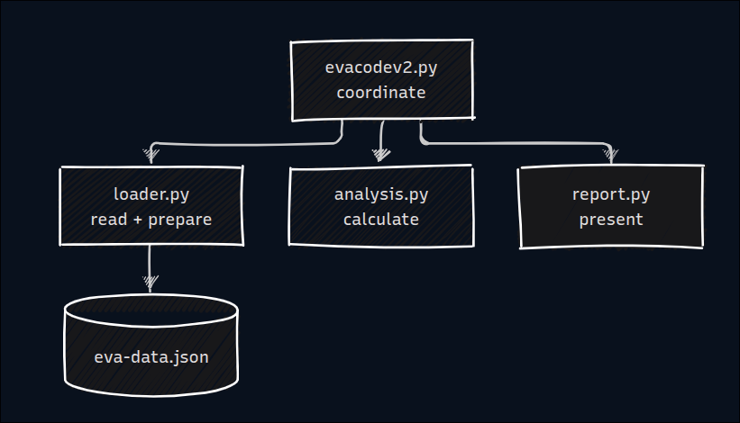

# Proposed Architecture

## Modules
- loader.py: read the JSON file and prepare clean records
- analysis.py: calculations only (no file reading or printing)
- report.py: print totals and draw charts
- evacodev2.py: coordinate (loader → analysis → report)

## Interfaces
- read_eva_file(path) returns raw dicts
- prepare_records(raw) returns a list of EvaRecord(date, hours, country, size)
- total_hours, cumulative_hours and hours_by(records, field) return numbers and dicts
- print_summary(...) and plot_charts(...) take results as parameters

## Dependencies
- Only evacodev2.py imports the other modules
- analysis and report don’t depend on each other

## Boundaries and cohesion
- One module per responsibility from AR1
- Each module groups the functions that share one concern: JSON format, calculations, or output

## Coupling fix (AR3)
- Inherited: printing and plotting use the global sorted_country_counts from the calculation loop.
- New: analysis returns a dict, and report takes it as a parameter.

## ADR-001: Split the script into four modules by responsibility
- Context: One script with shared globals that can’t be tested or changed in parts.
- Alternatives: One file with functions, four modules, five modules, classes.
- Decision: Four modules, keeping evacodev2.py as the entry point.
- Rationale: Meets AR1 to AR4 with the fewest files, preserves history, no new dependencies.
- Consequences: Testable calculations and easier changes. Trade-off: more files to navigate.

